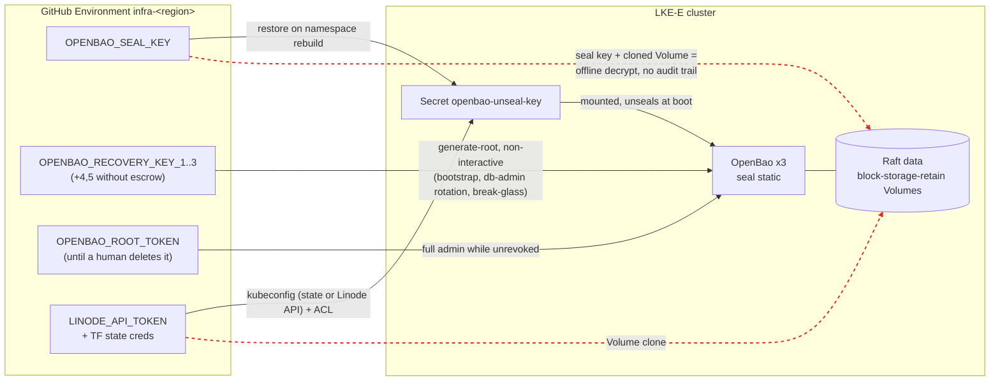

# ADR 0015 — Get OpenBao seal and recovery key material out of GitHub

- Status: Proposed
- Date: 2026-10-14 (revised 2026-10-15 after review)
- Deciders: platform / LLZ maintainers
- Related: [ADR 0001](0001-pat-rotation-locus.md) (where a credential lives decides its blast radius),
  [ADR 0004](0004-decouple-openbao-write-identity-from-cluster-access.md) (scoped OpenBao write identity),
  [ADR 0005](0005-managed-app-platform.md) (the apl-core boundary),
  [ADR 0009](0009-unmeasurable-credential-coverage.md) (write-time coverage for static credentials),
  [`docs/secrets.md`](../secrets.md), [`docs/e2e-gates.md`](../e2e-gates.md),
  PR [#571](https://github.com/akamai-consulting/lke-landing-zone/pull/571) (OpenBao Raft snapshots to object storage; open at the time of writing)

## Context

### What exists today

Every LLZ deployment runs its own three-node OpenBao Raft cluster per region. The
pinned server is **OpenBao 2.5.0** (`openbao/openbao` standard image,
[`kubernetes-charts/llz-openbao-platform/values.yaml`](../../kubernetes-charts/llz-openbao-platform/values.yaml),
`appVersion: "2.5.0"` in its `Chart.yaml`). LKE-Enterprise and Linode offer no
managed KMS, so the chart auto-unseals with OpenBao's `seal "static"` mechanism.
Three kinds of OpenBao key material make that work, and all three are written to
GitHub.

**1. The static seal key** — 32 random bytes, AES-256-GCM-96, which wraps
OpenBao's root key and therefore decrypts everything in the Raft store.

| Where | How it gets there | Reference |
|---|---|---|
| `llz-openbao/openbao-unseal-key` Secret (etcd, encrypted at rest by LKE-E), mounted at `/openbao/seal/unseal.key` | `llz ci bao-seed-seal-key` creates it before the pods start | [`sealkey.go`](../../tools/internal/extensions/lifecycle/openbao/sealkey.go), chart `server.volumes` |
| `OPENBAO_SEAL_KEY` secret on the `infra-<region>` GitHub Environment | on a first-ever bootstrap `resolveSealKey` generates the key **in the GitHub runner** (`crypto/rand`) **and** writes it there "for disaster recovery"; on a namespace rebuild it restores the Secret **from** there | `resolveSealKey` in [`sealkey.go`](../../tools/internal/extensions/lifecycle/openbao/sealkey.go); `Seed OpenBao static auto-unseal key` step in [`llz-bootstrap-openbao.yml`](../../instance-template/.github/workflows/llz-bootstrap-openbao.yml) |
| "offline storage" | the job summary tells the operator to copy it out of the Environment by hand; nothing checks that they did | same function |

The chart's `current_key_id` is fixed at `llz-openbao-static-1`, and the code and
docs treat the key as **never rotating**
([`credtargets.go`](../../tools/internal/shared/credtargets/credtargets.go) says a
rotation "means a seal rewrap of the whole store, which nothing here implements").
`llz ci clear-cluster-secrets` deletes `OPENBAO_SEAL_KEY` on teardown
([`cobra_clear_secrets.go`](../../tools/internal/shared/ghsecret/cobra_clear_secrets.go)),
while the Raft data sits on `block-storage-retain` Volumes that outlive the cluster.

**2. The recovery shares** — `llz ci bao-init` runs
`bao operator init -recovery-shares=5 -recovery-threshold=3`
([`ci_openbao_init.go`](../../tools/internal/extensions/lifecycle/openbao/ci_openbao_init.go)).
Under an auto-unseal seal these shares do not unseal; they authorize
`operator generate-root` and recovery-key rotation, i.e. they turn into a root
token on demand.

| `openbao_escrow_pubkey_b64` dispatch input | GitHub holds | Operator holds |
|---|---|---|
| set (one RSA public key) | shares 1–3 as `OPENBAO_RECOVERY_KEY_1/2/3` | all 5 shares, RSA-OAEP-encrypted to that **one** key (job summary + 1-day artifact) |
| empty (the default) | **all five**, `OPENBAO_RECOVERY_KEY_1`–`5` (`persistFallbackShares`) | nothing |

Either way shares 1–3 — a full quorum — live in GitHub, because three automated
paths regenerate root from them non-interactively:

- `llz ci bao-ensure-ready` in [`llz-bootstrap-openbao.yml`](../../instance-template/.github/workflows/llz-bootstrap-openbao.yml)
  (re-running bootstrap/configure against an initialized cluster);
- the same verb in the `rotate-db-admin` job of
  [`llz-secret-rotation.yml`](../../instance-template/.github/workflows/llz-secret-rotation.yml);
- `llz ci bao-breakglass` in
  [`llz-breakglass-openbao.yml`](../../instance-template/.github/workflows/llz-breakglass-openbao.yml)
  (generate / rotate / revoke a root token, returned RSA-encrypted).

The interactive twin, `llz openbao regen-root`
([`regenroot.go`](../../tools/internal/extensions/lifecycle/openbao/regenroot.go)),
already reads shares from a terminal in raw mode and is the only path that does
not need them in GitHub.

**3. The root token** — written to GitHub on three paths, each a full-admin
credential for as long as it is unrevoked.

| Writer | Reference |
|---|---|
| `llz ci bao-init` writes the init root token to `infra-<region>` as `OPENBAO_ROOT_TOKEN`, alongside shares 1–3 | `RunInit` in [`ci_openbao_init.go`](../../tools/internal/extensions/lifecycle/openbao/ci_openbao_init.go) |
| `llz ci bao-ensure-ready`, after regenerating root from the quorum, writes the new token there too | `RunRegenRootCI` in the same file |
| `llz openbao regen-root` optionally re-seeds it from an operator's terminal | `updateRootGHASecret` in [`regenroot.go`](../../tools/internal/extensions/lifecycle/openbao/regenroot.go) |

The bootstrap job's `Revoke root token` step revokes the token on success, and on
failure unless `preserve_root_on_failure` is set
([`llz-bootstrap-openbao.yml`](../../instance-template/.github/workflows/llz-bootstrap-openbao.yml)).
The **Actions secret** is not deleted by anything except teardown; it stays until a
human removes it. `llz status` nags about it (`warnIfRootTokenPresent` in
[`tools/internal/cli/commands.go`](../../tools/internal/cli/commands.go)) and the
credential single pane classes it "expected absent". A revoked token in the
secret is harmless, but the revoke can fail (the step only warns), and
`preserve_root_on_failure` deliberately leaves it live.

### Adjacent: apl-core's SealedSecrets controller key

LLZ's OpenBao is not the only in-cluster master key. apl-core ships no OpenBao, but
its bootstrap generates an RSA-4096 key pair for the Bitnami SealedSecrets
controller and stores it as the `sealed-secrets/sealed-secrets-key` Secret
(`generateSealedSecretsKeyPair` / `createSealedSecretsKeySecret` /
`getOrCreateSealedSecretsPem` in apl-core's `src/common/sealed-secrets.ts`).
apl-operator seals apl-core's platform secrets with it and pushes the resulting
SealedSecrets to the machine-owned `apl-<env>` branch of the instance repo
(`AplValuesBranch` in
[`clusterspec/types.go`](../../tools/internal/shared/clusterspec/types.go);
[`docs/designs/apl-core-values-branch-isolation.md`](../designs/apl-core-values-branch-isolation.md)).
LLZ itself does not seal anything with that key, and nothing in `tools/` backs it
up or references it.

Its exposure has exactly Option B's shape, below: the private key lives only in an
in-cluster Secret, and the ciphertext it protects lives in GitHub. Cluster-admin
reads the key once, and from then on every past and future commit to `apl-<env>`
decrypts offline. That is handled in the decision, and deliberately kept out of
this ADR's ceremony.

### What guards the `infra-<region>` Environment today

- A **main-only deployment-branch policy**, applied best-effort by
  `branchpolicy.Lock` ([`policy.go`](../../tools/internal/extensions/lifecycle/branchpolicy/policy.go)).
  It is skipped (warning only) on plans without environment protection: **private
  repositories on GitHub Free get neither deployment-branch policies nor required
  reviewers.** On those plans no Environment-level control in this ADR is
  available at all.
- **Required reviewers are not set by `llz`.** `Lock` preserves reviewers an
  operator configured by hand; the break-glass workflow header calls them a MUST.
- Secret **write time** is measured by the credential single pane (ADR 0009);
  `OPENBAO_ROOT_TOKEN` is the one OpenBao secret already "expected absent".

### The actual exposure

The premise "anyone who controls the GitHub Environment can unseal" is true, but
it understates one thing and overstates another, and the options below only make
sense against the precise version.

**Understated — the seal key works offline and forever.** A job in
`infra-<region>` also receives `LINODE_API_TOKEN` and the Terraform-state
credentials. From those the
[`cluster-access`](../../instance-template/.github/actions/cluster-access/action.yml)
action reads a cluster-admin kubeconfig out of Terraform state and opens the
runner's IP in the LKE-E control-plane ACL. The Linode API serves the same
kubeconfig directly (`GET lke/clusters/{id}/kubeconfig`, `GetKubeconfig` in
[`linode/lookup.go`](../../tools/internal/shared/linode/lookup.go)). Raft data
lives on `block-storage-retain` Linode Volumes. So a one-time read of that
Environment's secrets (a malicious step on `main`, a compromised action, a leaked
runner) yields the seal key **plus** an API token that can clone a Volume. That is
enough to decrypt the whole store on an attacker's machine. Once PR #571 lands,
the Raft snapshots in object storage are a second copy of the ciphertext, readable
with a key minted from the same `LINODE_API_TOKEN` (#571's own restore path does
exactly that). That path never touches OpenBao, so the OpenBao audit log sees
nothing. The OpenBao audit log is the only API audit stream LLZ ships
([`docs/secrets.md`, Audit logging](../secrets.md#audit-logging)). The key also
stays valid after every other credential is rotated, because it is never rotated.

**Overstated — removing the seal key from GitHub does not stop an attacker who
holds that Environment.** The same Environment mints cluster-admin, and
cluster-admin can read the in-cluster `openbao-unseal-key` Secret, or exec into an
unsealed pod. No in-cluster key placement changes that. A stolen copy of the
Environment's secrets is enough on its own, with **one online step while the
Linode and Terraform-state credentials in it are still valid**:

1. fetch the kubeconfig (Terraform state or the Linode API) and open the ACL;
2. read `llz-openbao/openbao-unseal-key` once;
3. clone a Raft Volume, or read a #571 snapshot.

After that, decryption is offline and permanent. That step is less visible than
the original review assumed:

- **LLZ ships no Kubernetes API audit log.** Nothing in this repo collects
  apiserver audit events. Whether LKE-E exposes them to the customer at all is
  **unverified**. A Secret `get` by a valid cluster-admin credential is therefore
  invisible to everything LLZ runs today.
- **Linode account events are the only provider-side trace**, and LLZ does not
  read them. The documented event actions
  ([Linode API: List events](https://techdocs.akamai.com/linode-api/reference/get-events),
  90-day retention) include `volume_clone`, `lke_control_plane_acl_update` and
  `obj_access_key_create`. They have **no event for fetching a kubeconfig**, only
  `lke_kubeconfig_regenerate`. Only `volume_clone` is a high-signal event: nothing
  in `tools/` clones a Volume. ACL updates happen on every CI job, and Object
  Storage keys are minted routinely by the rotation reconciler, so both are noise
  without correlation against known workflow runs.

So the honest summary is: Options A and B differ in whether the attacker needs that
one online step and an unexpired Linode token, not in whether a stolen secret set
can decrypt the store. **Only Options C and D close the path**, because there the
wrapping key is not in the cluster to read. What the options change:

1. whether a **stolen copy** of GitHub secrets decrypts the store with no online
   step at all, and keeps doing so after the Linode and state credentials are
   rotated (A: yes; B: no, it needs one step inside the credentials' lifetime;
   C/D: no);
2. whether **recovery shares** and a **root token** — a root-token quorum and its
   product — exist anywhere a single party controls;
3. whether the **seal key itself** can be extracted at all (only an external seal
   changes this).

### Constraints any option must respect

- **Two independent clusters per deployment.** Each region's OpenBao has its own
  seal key and its own shares; consistency is operator dual-write
  (`llz openbao set`), not replication. Every option is applied per region, and
  an option must not couple both regions to one external component, or it defeats
  the pair.
- **Auto-unseal is not negotiable.** LKE-E rolls nodes during upgrades; a Shamir
  seal would put a human in the loop for every pod restart. That is the reason the
  static seal replaced the old submit-keys cron.
- **No managed KMS, no HSM** on Linode or LKE-E.
- **OpenBao's seal surface.** Version claims are from the upstream
  [CHANGELOG](https://github.com/openbao/openbao/blob/main/CHANGELOG.md); the
  entry is named so it can be re-checked:
  - `static`: "Add static key unseal mechanism" under **2.4.0**. The
    [static seal docs](https://openbao.org/docs/configuration/seal/static/)
    describe `n-1` to `n` rotation through `previous_key` / `previous_key_id`.
    **What a rotation re-wraps is not stated there**, and nothing in this repo has
    run one. The working assumption — it re-wraps the root key and does not
    re-encrypt the store — is for the Phase 1 spike to confirm. The "never rotate"
    stance is an LLZ choice, not a documented OpenBao limit.
  - `transit` is built in.
  - `kmip`: "KMIP Auto-Unseal" first appears under **2.3.0-beta20250528** and in
    the **2.3.1** release.
  - `pkcs11`: "PKCS#11 Auto-Unseal" under **2.2.0**. Container images that carry
    it are the separate **HSM distribution** ("Alpine-based HSM container images",
    2.3.1). Whether the standard `openbao/openbao` image LLZ pins can use it at
    2.5.0 is **unverified**. Treat it as HSM-distribution-only until tested.
  - **2.6.0** adds "a new `kms` plugin type" for auto-unseal and announces that
    the HSM distribution "will be discontinued by v2.7.0".
  - **2.7.0**: "The `pkcs11`, `alicloudkms`, `awskms`, `azurekeyvault`, `gcpckms`
    and `ocikms` seals are no longer built-in", and the HSM distribution is
    discontinued. `static`, `transit` and `kmip` are not on that list.
- **OpenBao natively PGP-encrypts recovery shares**: `operator init
  -recovery-pgp-keys` (one key per share) at init, and `operator rotate-keys
  -target=recovery -pgp-keys` to re-shard an initialized cluster
  ([rotate-keys](https://openbao.org/docs/commands/operator/rotate-keys/)).
  Plaintext shares never leave the server. LLZ uses neither today; its escrow
  encrypts all five shares to **one** RSA key in the runner, which makes it
  single-custodian.
- **Rotating the seal key is not rotating the root key or the keyring.** These are
  three separate operations. The upstream docs below are written against 2.7.x,
  so availability at the pinned 2.5.0 is for the spike to confirm.
  - **Seal-key rotation** (`previous_key`): re-wraps the root key under a new seal
    key (assumed, see above).
  - **Root-key rotation**: `sys/rotate/root`, CLI `bao operator rotate-keys`
    (default `-target=barrier`). "When using Auto Unseal, the recovery key share(s)
    can be provided to rotate the root key"
    ([`sys/rotate` API](https://openbao.org/docs/api/system/rotate/)). Per the
    [rotation internals](https://openbao.org/docs/internals/rotation/) it
    generates a new root key and re-encrypts the keyring under it.
  - **Keyring rotation**: `sys/rotate/keyring`, CLI `bao operator rotate`
    ([operator rotate](https://openbao.org/docs/commands/operator/rotate/)). It
    adds a new encryption key for new writes. "Older keys are saved in the
    keyring", so existing data stays readable under its old key.

  The consequence: an old seal key plus a Volume clone taken under it yields the
  root key and every keyring term at that time. Rotating only the seal key leaves
  the **same** root key in place, so that attacker can also decrypt any **later**
  clone. Only root-key rotation stops that. Even then, entries written before the
  rotations stay readable with the old keyring, so the stored secrets themselves
  must be rotated too.

## Options

Each option is judged on: who can unseal or exfiltrate; failure modes (lost key,
external dependency down, cluster rebuild, the HA pair); operator burden; how an
existing deployment migrates; and the gate that would prove it works
([`docs/e2e-gates.md`](../e2e-gates.md)).

### Option A — Status quo plus compensating controls (baseline)

Keep the static seal and the GitHub-held material. Harden the boundary around it:
`llz` sets **required reviewers with `prevent_self_review`** on every
`infra-<region>` Environment (today it only preserves them), refuses to proceed
without a branch policy instead of warning, and alerts on every write to the
OpenBao key secrets.

- **Threat model.** Unchanged in kind. A reviewer-approved job on `main` still
  receives a quorum and the seal key; a stolen copy still decrypts offline with no
  online step. GitHub org owners and repo admins can change the protection rules.
  Reviewers reduce *casual* misuse; they do nothing against a malicious change
  that merges to `main` and a reviewer then approves as routine. On GitHub Free
  private repos none of these controls exist.
- **Failure modes.** Best of the four for availability: no new dependency. Lost
  key: the GitHub copy is the DR copy. GitHub as a DR store is itself a risk —
  secrets are write-only in the UI and can only be read back by running a job.
  `clear-cluster-secrets` deletes the key on teardown, so a retained Raft Volume
  outlives its only key.
- **Burden.** Lowest. Reviewers slow down the scheduled `rotate-db-admin` job,
  which now needs an approval to run.
- **Migration.** None. One `llz` change plus re-running the environment lock.
- **Gate.** Static and API-level: a check that reads each `infra-<region>`
  Environment's protection rules back through the GitHub API and fails if
  `required_reviewers` is missing. It fails closed when the API returns no
  Environments, and treats "the plan does not support it" as a failure the adopter
  must explicitly acknowledge, not a pass.

### Option B — Seal key in-cluster only; recovery shares PGP-encrypted to named custodians

Stop writing OpenBao key material to GitHub at all, and make a k-of-n set of named
humans the DR path.

1. **Recovery shares.** Declare custodians (name + PGP public key) in the instance
   spec (public keys may be committed). First init passes them to
   `-recovery-pgp-keys` with the declared threshold, so OpenBao returns only
   ciphertext and no plaintext share ever reaches a runner. Nothing is written to
   `OPENBAO_RECOVERY_KEY_*`.
2. **The root token.** The init root token is used in-memory within the job and
   revoked there, and is **never written to `OPENBAO_ROOT_TOKEN`**. The two reasons
   `RunInit` gives for persisting it (the configure preflight's sha256
   comparison, and keeping the GHA copy current for `regen-root`) both disappear
   once nothing reads a root token from GitHub. `regen-root` loses its
   `updateRootGHASecret` re-seed. Root tokens from a custodian ceremony are
   returned to the operator's terminal only.
3. **The non-interactive root paths go away.** `rotate-db-admin` gets a scoped
   GitHub-OIDC role (the `secret-propagator` pattern from ADR 0004) instead of
   root. Re-configuring an initialized cluster gets a scoped `configurator` role
   (see the recommended answer to open question 4). The break-glass workflow
   retires its quorum-from-secrets mode in favour of `llz openbao regen-root`, run
   locally with custodians typing their decrypted shares.
4. **The seal key is generated in-cluster, not in the runner.** Replace the
   runner-side `resolveSealKey` generation with a one-shot Kubernetes Job (the
   `llz` image, the pattern the in-cluster CronJobs already use). The Job
   generates the 32 bytes, creates the `openbao-unseal-key` Secret, Shamir-splits
   the key k-of-n and encrypts each piece to one custodian's PGP key. It emits
   **only that ciphertext** (a ConfigMap the runner reads into the job summary
   and a short-lived artifact). The plaintext key exists in the Job's memory and
   the Secret, nowhere else. Two caveats:
   - Kubernetes RBAC `resourceNames` cannot restrict `create`, so the Job's
     ServiceAccount can create any Secret in `llz-openbao`; keep that namespace
     otherwise empty of writable Secrets.
   - A malicious cluster-admin runner can still read the Secret afterwards. The
     Job removes the runner from the key's **designed** path, not from its reach.

   An `llz openbao custody restore-seal-key` ceremony rebuilds the Secret from k
   custodian pieces for namespace loss.
5. **A ceremony command** — `llz openbao custody` — covers custodian rotation
   (`rotate-keys -target=recovery` with a new key list), seal-key re-escrow, the
   brownfield migration below, and a periodic "prove you can still decrypt" drill.
   Custodians need **`gpg` (or another OpenPGP tool) on the machine they decrypt
   on at incident time**. Today's RSA escrow needs only `openssl`. The runbook and
   the drill must exercise the custodian's real decrypt path, not a test key in
   CI.

- **Threat model.** A stolen copy of GitHub secrets no longer contains OpenBao key
  material, but it is **still sufficient, with one online step while its Linode
  and Terraform-state credentials are valid**: kubeconfig → ACL → read the Secret
  → clone a Volume (see "The actual exposure"). What B buys is narrower:
  - the stolen copy expires with those credentials, instead of decrypting forever;
  - the attacker must act against the live control plane;
  - the step leaves a `volume_clone` (or `obj_access_key_create`) Linode account
    event.

  B does **not** make that step visible by itself. LLZ ships no Kubernetes audit,
  and reading Linode events is new work (Phase 3 below). If an adopter needs the
  path closed rather than shortened, only C/D do that. The recovery quorum
  requires k custodians to collude. Custodian private keys become the new crown
  jewels. **GitHub still controls OpenBao online**: the scoped OIDC roles,
  `configurator` especially, are bound to `main` and the Environment. B removes
  the offline, unexpiring path, not GitHub's administrative reach.
- **Failure modes.**
  - *Lost key:* the custodian escrow is the only DR copy. Losing more than n−k
    custodians' keys loses the ability to restore a lost Secret. The running
    cluster keeps working, and a periodic decrypt drill finds the loss before it
    matters.
  - *External dependency down:* none at runtime. Unseal stays fully automatic.
  - *Cluster rebuild:* a greenfield rebuild mints a new key and new escrow (no
    change from today). Re-attaching retained Volumes, or restoring a #571
    snapshot into a fresh cluster, needs the old key from the custodians. That is
    a ceremony instead of an automatic restore. Whether a snapshot restores under
    a **rotated** seal key is unverified; the spike checks it.
  - *Teardown:* see "DR across teardown" below. Under B the escrow is the **only**
    route back to retained Volumes or snapshots.
  - *HA pair:* per-region escrow, same custodian set. Losing one region's key
    loses only that region's store, and the dual-written paths survive on the peer.
- **Burden.** Moderate and front-loaded: custodians must exist, hold PGP keys and
  `gpg`, and attend ceremonies (DR, custodian change, the brownfield migration).
  Day-2 automation gets *simpler*, because no workflow handles shares.
- **Migration** (per region, brownfield; every existing adopter is here):
  1. **Re-shard recovery.** Use the GitHub-held quorum one last time for
     `bao operator rotate-keys -target=recovery -pgp-keys=<custodians>` with the
     declared threshold. The old shares become invalid the moment that completes.
  2. **Rotate the root key** with the **new** custodian shares (`bao operator
     rotate-keys -target=barrier`, driven by recovery shares under auto-unseal).
     That re-encrypts the keyring under a root key the old seal key never wrapped.
  3. **Rotate the keyring** (`bao operator rotate`), so new writes use a term the
     old keyring does not contain.
  4. **Rotate the static seal key** to one generated in-cluster by the Job above
     (`current_key` new, `previous_key` old, a new `current_key_id`), and escrow
     the new key. Once every pod has restarted on the new stanza, drop
     `previous_key`.
  5. **Delete** `OPENBAO_SEAL_KEY`, `OPENBAO_RECOVERY_KEY_*` and
     `OPENBAO_ROOT_TOKEN` from `infra-<region>`.
  6. **Rotation does not protect historical copies.** The old seal key plus a
     Volume clone or #571 snapshot taken **before** step 2 still yields the old
     root key and the old keyring, and so every entry written before step 3. An
     adopter who fears past exposure must also rotate the secrets stored in
     OpenBao, and should expire #571 snapshots older than the migration.

  Steps 2–4 rest on the semantics in "Rotating the seal key is not rotating the
  root key" above. **None has been run against 2.5.0 in this repo**, so all three
  are spike items. If the spike shows root-key rotation is unavailable or behaves
  differently at 2.5.0, B's migration is not sufficient and this ADR is revised
  before Phase 3.
- **Gates.**
  - *Round trip (split contract):* an e2e lane that inits with throwaway custodian
    keys, decrypts k shares with the matching private keys, and drives the real
    `regen-root` flow to a token that passes `token lookup`. It uses both sides'
    real functions, and fails closed on fewer than k shares or a zero-length share
    list.
  - *Restore (unverified delivery):* delete the `openbao-unseal-key` Secret and a
    pod, restore it through the ceremony, and require the pod to report
    `sealed=false` **and** a canary KV value to read back. "Unsealed" alone does not
    prove the data decrypts.
  - *Brownfield migration (unappliable change):* the lane
    [`docs/e2e-gates.md`](../e2e-gates.md#the-configuration-no-lane-runs-an-upgrade-over-existing-state)
    says no one runs, specialised to this migration. Greenfield lanes cannot see
    it, and it is the path every adopter takes:
    1. bootstrap an instance at **release N−1**, so shares 1–3, the seal key and
       a root token are in GitHub as they are today, and write a canary KV value;
    2. `llz upgrade` it to the commit under test and run `llz openbao custody
       migrate` with throwaway custodian keys;
    3. assert that `generate-root` driven by the **old** GitHub-held shares is
       **rejected**;
    4. assert that k decrypted custodian shares produce a root token that passes
       `token lookup`;
    5. assert that the canary still reads back;
    6. assert that all three secret families are absent from `infra-<region>`;
    7. assert that `sys/seal-status` reports the new `current_key_id`.

    The lane fails closed if step 1 did not actually leave the old material in
    GitHub, because that would turn the migration into a greenfield run. It
    inherits the tag-rendering prerequisite `e2e-gates.md` names for
    `e2e-instantiate.yml`.
  - *Absence (reporting):* flip `OPENBAO_SEAL_KEY` / `OPENBAO_RECOVERY_KEY_*` to
    "expected absent" in `credtargets`, alongside `OPENBAO_ROOT_TOKEN`, so the
    credential single pane alerts on every real deployment that has not migrated.

### Option C — Transit auto-unseal against a key held outside the cluster

Point `seal "transit"` at an OpenBao or Vault outside the deployment, possibly one
whose own seal is HSM-backed. The wrapping key never leaves that system. LLZ
OpenBao holds only a transit token (scoped to `encrypt`/`decrypt` on one key).

- **What it depends on.** A reachable, TLS-protected, highly available transit
  service. Who runs it is the real question. Choices: the adopter's existing
  enterprise Vault/OpenBao; a small dedicated "seal cluster" on separate
  infrastructure, Shamir-sealed and unsealed by humans; or each region's OpenBao
  sealing the other's ("mutual transit"). Mutual transit is circular — if both
  regions restart together, neither can unseal — and it couples the pair it exists
  to keep independent. **Rejected outright.**
- **Bootstrap chicken-and-egg.** The transit service must be up, unsealed and
  provisioned (key, policy, token) before LLZ's OpenBao can even `init`. Its own
  unseal cannot depend on anything LLZ manages. The transit token has to reach the
  cluster somehow — the same delivery problem as the seal key, but the payload is
  revocable and useless off-network.
- **Threat model.** Best of the four for the seal key: it cannot be exfiltrated
  from LLZ at all. A stolen transit token is an online decrypt oracle, revocable
  and audited on the transit side. A stolen Volume clone is undecryptable without
  live transit access. Cluster-admin on a running cluster still owns the
  **running** OpenBao. Recovery shares still need custodians — Option B's share
  half applies unchanged.
- **Failure modes.**
  - *External dependency down:* running pods keep serving. Any pod that restarts
    stays sealed. An LKE-E node upgrade during a transit outage therefore seals
    nodes one by one until Raft loses quorum and OpenBao is down. This is a new,
    correlated availability coupling.
  - *Lost key:* if the transit key is lost, every LLZ store it wrapped is lost.
    The external service's own backups become LLZ's DR.
  - *Cluster rebuild:* clean; a new cluster gets a new transit key or reuses the
    old one to re-attach Volumes.
  - *HA pair:* each region needs a transit backend whose failure domain is
    independent of the other region's, or the pair shares one point of failure.
- **Burden.** Highest ongoing: a second secrets system to run, patch, monitor,
  back up and unseal, outside the landing zone. Acceptable for adopters who already
  run one; an unreasonable default for those who do not.
- **Migration.** OpenBao seal migration: add the `transit` stanza, mark `static`
  `disabled = "true"`, restart with `-migrate`, then remove `static`. It runs once
  per region and needs a maintenance window and a rehearsed rollback. A greenfield
  deployment just starts on transit. The same historical-copy caveat as B's step 6
  applies to clones taken under the static key.
- **Gates.**
  - *Ground truth, not config:* read `sys/seal-status` and require
    `type == "transit"` on every pod. A rendered stanza is not proof.
  - *Delivery:* restart one pod and require it to unseal within a bounded budget.
  - *Negative:* with egress to the transit endpoint blocked, a restarted pod
    **stays sealed**. That proves the key actually comes from transit, not from a
    forgotten static stanza.

### Option D — PKCS#11 / HSM seal, KMIP, or a cloud KMS seal

- **PKCS#11.** At the pinned 2.5.0 it is assumed to need the HSM image
  distribution (unverified, see the constraints). From 2.6.0 it is also available
  as a KMS plugin, and from 2.7.0 it is plugin-only, with the HSM distribution
  gone. Both routes need a vendor PKCS#11 library in the pod and a **network
  HSM** reachable from LKE-E. Linode offers none, so it is adopter-supplied. A
  software token such as SoftHSM puts the key back in a file and buys nothing.
- **KMIP.** In the CHANGELOG since 2.3.x and not on 2.7.0's de-built-in list.
  Whether the standard image at 2.5.0 carries it is to be confirmed in Phase 4. It
  needs an adopter-run KMIP server (an enterprise KMS or HSM appliance). Same
  shape as Option C, with mTLS client credentials to deliver.
- **Cloud KMS** (`awskms`, `gcpckms`, `azurekeyvault`, …). Built in before 2.7.0,
  plugin-only from 2.7.0. Usable cross-cloud from Linode, but the KMS credential
  must reach the pod. Static IAM keys are one more long-lived secret, likely back
  in GitHub. Workload-identity federation would need LKE-E's ServiceAccount
  issuer to be trusted by the cloud provider (unverified).
- **Threat model / failure modes / gates.** As Option C: the key cannot be
  exfiltrated, there is runtime availability coupling to the provider, and the
  same three gates apply. Add a cross-provider dependency and egress.
- **Burden / migration.** As Option C, plus an OpenBao version bump to reach the
  plugin model on the 2.7 line, where the built-ins disappear. Seal migration is
  the same procedure.

### Summary

| | Stolen GitHub secrets decrypt the store | Root quorum held by | Seal key extractable by cluster-admin | New runtime dependency | Operator burden | Brownfield migration |
|---|---|---|---|---|---|---|
| A — status quo + controls | **yes, offline, no online step, forever** | GitHub Environment | yes | none | low | none |
| B — in-cluster key + custodians | **yes, with one online step** while the Linode/TF credentials are valid | k of n custodians | yes | none | moderate (ceremonies, `gpg`) | re-shard + root/keyring/seal rotation, per region |
| C — external transit | no | k of n custodians (B's half) | **no** | transit service, HA | high | seal migration, per region |
| D — HSM / KMIP / cloud KMS | no | k of n custodians (B's half) | **no** | HSM / KMS provider | high | seal migration (+ version bump) |

### DR across teardown

`clear-cluster-secrets` deletes `OPENBAO_SEAL_KEY` today, while the Raft Volumes
are retained on purpose. Today that silently orphans retained data unless the
operator made the offline copy the summary asked for. Under B, custodian escrow
is the **only** route back to retained Volumes, and to #571 snapshots, which
cannot be restored into a fresh cluster without the source cluster's seal key.
So, once Phase 3 lands:

- teardown **refuses** to proceed on a deployment whose escrow has not been
  confirmed. Confirmed means a decrypt drill recorded within a configurable window
  in which k custodians each decrypted their seal-key piece and the recombined key
  matched the live key's fingerprint. The only bypass is an explicit
  `--abandon-openbao-data` acknowledgement, which writes to the job summary;
- the escrow ciphertext and the custodian list are retained with the Volumes, and
  are not deleted with the cluster.

## Decision (proposed)

**Adopt Option B as the default, keep Option A's controls as a floor under it, and
make Options C/D an adopter-selectable seal mode — not the default.**

- B removes every piece of OpenBao key material from GitHub: seal key, recovery
  shares **and** root token. It turns a copied secret set from "permanent offline
  decrypt" into "one online step against the live control plane, inside the
  lifetime of the Linode and Terraform-state credentials, leaving a Linode account
  event". It adds no runtime dependency on a platform that has no KMS to depend
  on. It does **not** close that path and does not by itself detect it; that is
  stated in the threat model rather than implied.
- C and D are the only options that close the path. They buy that with an
  external system whose outage can seal the cluster during an ordinary node
  upgrade. That is a reasonable trade for adopters who already operate such a
  system, and the wrong thing to impose on everyone. Their recovery-share half is
  Option B's anyway, so B is not wasted work for them.
- A alone is rejected as an end state, but required reviewers are cheap and
  reduce misuse of the scoped CI identities that remain, so they ship first.
- **apl-core's SealedSecrets key is out of scope for this ceremony**, explicitly:
  - it is apl-core-owned (ADR 0005): apl-core generates it and apl-operator
    seals with it, so a custody scheme for it has to live upstream or be agreed
    with apl-core, not be bolted on by LLZ;
  - it protects apl-core's platform secrets, not the OpenBao store. Whether those
    are re-derivable after key loss is **not verified here**.

  Its exposure (in-cluster private key, ciphertext in GitHub) is the same as B's.
  This ADR records it as a known gap and a follow-up: at minimum, bring it into
  the Phase 3 teardown escrow check and the Linode-event detection, and raise a
  key-custody issue with apl-core.

## Adopter-configurable surface

LLZ is a template. Each of these is a spec field with a default, not a constant.
Illustrative shape only, and not a committed schema: an instance-wide
`spec.openbao.custody` block next to the existing `spec.openbao` extensions
([`docs/landing-zone-spec.md`](../landing-zone-spec.md)), plus `spec.openbao.seal`.

| Setting | Default (recommended) | Notes |
|---|---|---|
| Custodians | none; required for Phase 2+ | name + PGP public key each; same set for both regions |
| Recovery threshold k / count n | 3 of 5 | validated `2 ≤ k ≤ n`; matches today's `-recovery-threshold=3` |
| Seal-key escrow threshold | same k of n | see open question 2 |
| Fewer than k custodians declared | **refuse** | `allowUnderQuorum: true` permitted only on deployments marked lab/e2e. It is reported on the credential single pane, never silent |
| Phase 0 reviewer list | none; required unless acknowledged | GitHub users/teams applied as required reviewers + `prevent_self_review` |
| Plan lacks environment protection (GitHub Free private repos) | **refuse** | explicit acknowledgement only; the floor does not exist on that plan |
| Seal mode | `static` | `transit` / `kmip` in Phase 4; others after an OpenBao bump |
| Escrow-confirmation window for teardown | 90 days | see "DR across teardown" |

## Implementation plan

Rough effort, one engineer familiar with the codebase. Each phase is shippable on
its own and names its gate.

| Phase | Scope | Effort | Gate |
|---|---|---|---|
| **0 — Controls floor** | `branchpolicy.Lock` sets required reviewers + `prevent_self_review` from the declared reviewer list; a missing branch policy or an unprotectable plan fails unless explicitly acknowledged | 1–2 days | Protection rules read back from the GitHub API, failing closed on zero Environments |
| **1 — Spike** | On a lab cluster at 2.5.0, confirm: `-recovery-pgp-keys`; `rotate-keys -target=recovery -pgp-keys`; root-key rotation via recovery shares (`rotate-keys -target=barrier`); keyring rotation (`operator rotate`); static-seal `previous_key` rotation and **what it re-wraps**. Measure what an old seal key plus a pre-rotation Volume clone still decrypts after each step. Check whether a #571 snapshot restores under a rotated seal key | 3–4 days | Written result appended to this ADR; go/no-go for phases 2–3 |
| **2 — Recovery shares and root token out of GitHub** | Custodian spec; PGP init; `llz openbao custody rotate-recovery`; scoped OIDC roles for `rotate-db-admin` and re-configure; break-glass becomes local-only; stop writing `OPENBAO_RECOVERY_KEY_*` and `OPENBAO_ROOT_TOKEN`; `credtargets` flips the shares to expected-absent | 6–9 days | Round-trip lane; brownfield lane (recovery half: old shares rejected, custodian shares mint root, canary reads); absence alert on real deployments |
| **3 — Seal key out of GitHub** | In-cluster seal-key Job + escrow; `custody restore-seal-key`; `custody migrate` (root, keyring and seal rotation); stop writing `OPENBAO_SEAL_KEY`; teardown refuses without confirmed escrow; Linode account-event check for `volume_clone` / `obj_access_key_create` not attributable to a workflow run; docs (`secrets.md`, bootstrap and break-glass runbooks, custodian `gpg` prerequisites) | 6–8 days | Restore lane (delete Secret + pod → restore → unsealed **and** canary readable); brownfield lane (full); teardown-refusal unit test; absence alert |
| **4 — Optional external seal** | `spec.openbao.seal` mode (`static` default, `transit`, `kmip`); seal-migration runbook; evaluate the 2.6+/2.7 plugin model before offering PKCS#11 or cloud KMS | 8–12 days | `sys/seal-status` type check; bounded unseal-after-restart; sealed-when-transit-unreachable negative |

Phases 2 and 3 change wire-visible operator workflows (break-glass, bootstrap
re-runs, DR, teardown). Each needs an `llz upgrade` note and the brownfield lane,
because every existing deployment starts with the material in GitHub.

## Consequences

- Day-2 CI no longer handles OpenBao key material or root tokens. The two jobs
  that regenerate root today stop doing so, and `OPENBAO_ROOT_TOKEN` stops being
  written at all, which closes the "root token parked in GitHub" class of finding
  at the source rather than by reminder.
- GitHub keeps online administrative reach through the scoped OIDC roles. The
  Environment protections (Phase 0) remain load-bearing.
- DR becomes a human ceremony with a quorum, not a re-run. That is slower by
  design, and it fails if custodians lapse — hence the decrypt drill, which
  teardown now depends on.
- The in-cluster Secret is the only live seal-key copy under B, so LKE-E etcd
  encryption and cluster-admin hygiene (ADR 0004 Phase 2) carry more weight.
- Custodians take on a tooling dependency (`gpg`) at incident time that today's
  `openssl`-only escrow avoided.
- `credtargets.go` and `docs/secrets.md` currently say seal-key rotation needs a
  whole-store rewrap. The static-seal docs describe `previous_key` rotation
  without saying what it rewraps. Phase 1 settles it and Phase 3 corrects both.

## Open questions

Each has a recommended answer so the ADR can be reviewed as a whole. Questions 1,
2 and 4 are load-bearing and must be settled before this moves to Accepted.

1. **Custodian key format.** OpenBao's native share encryption is PGP-only. The
   current escrow and break-glass delivery use RSA PEM + `openssl`, chosen so no
   gpg is needed at incident time.
   *Recommended:* **PGP.** It is native, and no plaintext share passes through the
   runner. Accept the `gpg` dependency and cover it in the drill. The seal-key Job
   then needs an OpenPGP encryptor in `tools/`, which is stdlib-first
   ([`docs/agents.md`](../agents.md)). `golang.org/x/crypto/openpgp` is already in
   the module graph but marked deprecated upstream ("unsafe by design"). The
   maintained alternative would be a new dependency. That choice is part of
   settling this question.
2. **Seal-key escrow shape.**
   *Recommended:* **Shamir k-of-n with the same k as the recovery quorum.** The
   alternative, encrypting the whole key to each custodian (1-of-n), is weaker
   than the 3-of-5 recovery quorum it sits beside: any **one** custodian plus a
   cloned Volume or a #571 snapshot decrypts the store, so the escrow, not the
   quorum, would set the real threshold. GF(256) Shamir is small enough to write
   against the stdlib, but it is cryptographic code. It needs a vetted reference
   implementation to test against (OpenBao's own is the obvious one), not just
   round-trip tests of itself.
3. **Default threshold and custodian count, and lab/e2e.**
   *Recommended:* 3 of 5, adopter-configurable; refuse to bootstrap with fewer
   than k custodians, except on deployments marked lab/e2e with an explicit
   `allowUnderQuorum`, which the single pane reports.
4. **Re-configure on an initialized cluster.** A scoped OIDC `configurator` role,
   or a custodian ceremony every time `bao-configure` changes?
   *Recommended:* **the `configurator` role**, stated plainly for what it is. It
   writes auth methods, policies and the audit device, which is near-root, and it
   is bound to `main` and the `infra-<region>` Environment. **GitHub therefore
   still controls OpenBao online under B.** B removes the offline, unexpiring path
   and the standing root quorum. It does not remove GitHub as an administrator. A
   ceremony on every configure change would make routine drift fixes a quorum
   event, and push operators back toward parking a root token. Adopters who
   cannot accept GitHub as an online administrator need the ceremony mode, and
   should also be on C/D.
5. **Required reviewers on scheduled jobs.** Phase 0 makes `rotate-db-admin` wait
   for approval.
   *Recommended:* accept it for Phase 0. Once Phase 2 removes key material from
   `infra-<region>`, move that job to an Environment without key material or
   reviewers.
6. **External seal appetite.** Do any adopters already run an enterprise
   Vault/OpenBao, KMIP or network HSM they would point LLZ at?
   *Recommended:* if none do, Phase 4 waits; B ships regardless.
7. **OpenBao version.** The 2.7 line moves PKCS#11 and cloud KMS to plugins and
   drops the HSM image.
   *Recommended:* sequence Phase 4 after an OpenBao upgrade to the 2.7 line rather
   than building against 2.5.0's built-ins. Run the Phase 1 spike on 2.5.0 (the
   pinned version) and repeat its rotation checks on the target version before the
   bump.
