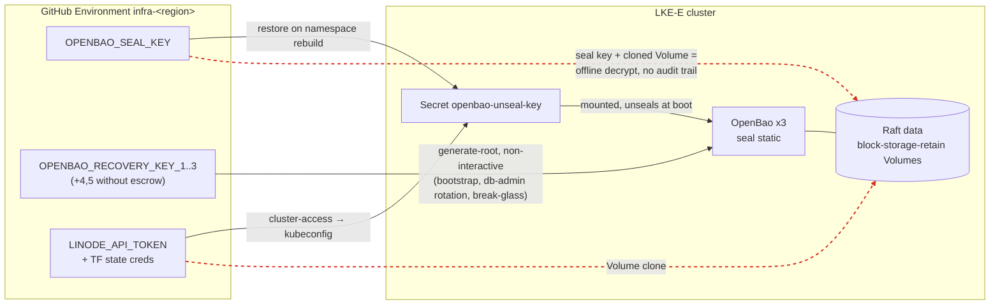

# ADR 0015 — Get OpenBao seal and recovery key material out of GitHub

- Status: Proposed
- Date: 2026-10-14
- Deciders: platform / LLZ maintainers
- Related: [ADR 0001](0001-pat-rotation-locus.md) (where a credential lives decides its blast radius),
  [ADR 0004](0004-decouple-openbao-write-identity-from-cluster-access.md) (scoped OpenBao write identity),
  [ADR 0009](0009-unmeasurable-credential-coverage.md) (write-time coverage for static credentials),
  [`docs/secrets.md`](../secrets.md), [`docs/e2e-gates.md`](../e2e-gates.md)

## Context

### What exists today

Every LLZ deployment runs its own three-node OpenBao Raft cluster per region. The
pinned server is **OpenBao 2.5.0** (`openbao/openbao` standard image,
[`kubernetes-charts/llz-openbao-platform/values.yaml`](../../kubernetes-charts/llz-openbao-platform/values.yaml),
`appVersion: "2.5.0"` in its `Chart.yaml`). LKE-Enterprise and Linode offer no
managed KMS, so the chart auto-unseals with OpenBao's `seal "static"` mechanism.
Two kinds of key material make that work, and both are held in GitHub.

**1. The static seal key** — 32 random bytes, AES-256-GCM-96, which wraps
OpenBao's root key and therefore decrypts everything in the Raft store.

| Where | How it gets there | Reference |
|---|---|---|
| `llz-openbao/openbao-unseal-key` Secret (etcd, encrypted at rest by LKE-E), mounted at `/openbao/seal/unseal.key` | `llz ci bao-seed-seal-key` creates it before the pods start | [`sealkey.go`](../../tools/internal/extensions/lifecycle/openbao/sealkey.go), chart `server.volumes` |
| `OPENBAO_SEAL_KEY` secret on the `infra-<region>` GitHub Environment | on a first-ever bootstrap the same command generates the key **and** writes it there "for disaster recovery"; on a namespace rebuild it restores the Secret **from** there | `resolveSealKey` in [`sealkey.go`](../../tools/internal/extensions/lifecycle/openbao/sealkey.go); `Seed OpenBao static auto-unseal key` step in [`llz-bootstrap-openbao.yml`](../../instance-template/.github/workflows/llz-bootstrap-openbao.yml) |
| "offline storage" | the job summary tells the operator to copy it out of the Environment by hand; nothing checks that they did | same function |

The chart's `current_key_id` is fixed at `llz-openbao-static-1`, and the code and
docs treat the key as **never rotating** (`credtargets.go` says a rotation "means
a seal rewrap of the whole store, which nothing here implements").
`llz ci clear-cluster-secrets` deletes `OPENBAO_SEAL_KEY` on teardown
([`cobra_clear_secrets.go`](../../tools/internal/shared/ghsecret/cobra_clear_secrets.go)).

**2. The recovery shares** — `llz ci bao-init` runs
`bao operator init -recovery-shares=5 -recovery-threshold=3`
([`ci_openbao_init.go`](../../tools/internal/extensions/lifecycle/openbao/ci_openbao_init.go)).
Under an auto-unseal seal these shares do not unseal; they authorize
`operator generate-root` and recovery-key rotation, i.e. they turn into a root
token on demand.

| `openbao_escrow_pubkey_b64` dispatch input | GitHub holds | Operator holds |
|---|---|---|
| set (one RSA public key) | shares 1–3 as `OPENBAO_RECOVERY_KEY_1/2/3` | all 5 shares, RSA-OAEP-encrypted to that **one** key (job summary + 1-day artifact) |
| empty (the default) | **all five**, `OPENBAO_RECOVERY_KEY_1`–`5` (`persistFallbackShares`) | nothing |

Either way shares 1–3 — a full quorum — live in GitHub, because three automated
paths regenerate root from them non-interactively:

- `llz ci bao-ensure-ready` in [`llz-bootstrap-openbao.yml`](../../instance-template/.github/workflows/llz-bootstrap-openbao.yml)
  (re-running bootstrap/configure against an initialized cluster);
- the same verb in the `rotate-db-admin` job of
  [`llz-secret-rotation.yml`](../../instance-template/.github/workflows/llz-secret-rotation.yml);
- `llz ci bao-breakglass` in
  [`llz-breakglass-openbao.yml`](../../instance-template/.github/workflows/llz-breakglass-openbao.yml)
  (generate / rotate / revoke a root token, returned RSA-encrypted).

The interactive twin, `llz openbao regen-root`
([`regenroot.go`](../../tools/internal/extensions/lifecycle/openbao/regenroot.go)),
already reads shares from a terminal in raw mode and is the only path that does
not need them in GitHub.

### What guards the `infra-<region>` Environment today

- A **main-only deployment-branch policy**, applied best-effort by
  `branchpolicy.Lock` ([`policy.go`](../../tools/internal/extensions/lifecycle/branchpolicy/policy.go)).
  It is skipped (warning only) on plans without environment protection — private
  repos on GitHub Free.
- **Required reviewers are not set by `llz`.** `Lock` preserves reviewers an
  operator configured by hand; the break-glass workflow header calls them a MUST.
- Secret **write time** is measured by the credential single pane (ADR 0009);
  `OPENBAO_ROOT_TOKEN` is the one OpenBao secret already "expected absent".

### The actual exposure

The premise "anyone who controls the GitHub Environment can unseal" is true, but
it understates one thing and overstates another, and the options below only make
sense against the precise version.

**Understated — the seal key works offline and forever.** A job in
`infra-<region>` also receives `LINODE_API_TOKEN` and the Terraform-state
credentials, from which the
[`cluster-access`](../../instance-template/.github/actions/cluster-access/action.yml)
action derives a cluster-admin kubeconfig. Raft data lives on
`block-storage-retain` Linode Volumes. So a one-time read of that Environment's
secrets (a malicious step on `main`, a compromised action, a leaked runner) yields
the seal key **plus** an API token that can clone a Volume — enough to decrypt the
whole store on an attacker's machine. That path never touches OpenBao, so the
OpenBao audit log (the platform's main detective control for secret access) sees
nothing, and the key stays valid after every other credential is rotated, because
it is never rotated.

**Overstated — removing the seal key from GitHub does not stop a live attacker who
holds that Environment.** The same Environment mints cluster-admin, and
cluster-admin can read the in-cluster `openbao-unseal-key` Secret, or exec into an
unsealed pod. No seal choice changes that: anything that can run code as
cluster-admin next to an unsealed OpenBao owns it. What the options below change
is narrower and still worth having:

1. whether a **stolen copy** of GitHub secrets is sufficient on its own (offline,
   unaudited, permanently), or whether the attacker must act live, through the
   LKE-E control-plane ACL, in a window the audit log and alerts can see;
2. whether **recovery shares** — a root-token quorum — exist anywhere a single
   party controls;
3. whether the **seal key itself** can be extracted at all (only an external seal
   changes this).

### Constraints any option must respect

- **Two independent clusters per deployment.** Each region's OpenBao has its own
  seal key and its own shares; consistency is operator dual-write
  (`llz openbao set`), not replication. Every option is applied per region, and
  an option must not couple both regions to one external component, or it defeats
  the pair.
- **Auto-unseal is not negotiable.** LKE-E rolls nodes during upgrades; a Shamir
  seal would put a human in the loop for every pod restart. That is the reason the
  static seal replaced the old submit-keys cron.
- **No managed KMS, no HSM** on Linode or LKE-E.
- **OpenBao's seal surface at 2.5.0** (from the upstream CHANGELOG — checked, not
  assumed):
  - `static` since 2.4.0; it supports rotation through `previous_key` /
    `previous_key_id`, which only re-wraps the root key, not the store. The
    "never rotate" stance is an LLZ choice, not an OpenBao limit.
  - `transit` is built in.
  - `kmip` since 2.3.0, built in.
  - `pkcs11` since 2.2.0, but at 2.5.0 only in the separate **HSM distribution**
    (`openbao-hsm` images), not the `openbao/openbao` image LLZ pins.
  - Cloud KMS seals (`awskms`, `gcpckms`, `azurekeyvault`, `ocikms`,
    `alicloudkms`) are built in at 2.5.0.
  - 2.6.0 added external **KMS plugins**. 2.7.0 removed `pkcs11` and the cloud KMS
    seals from the binary (plugin-only) and discontinued the HSM distribution.
    `static`, `transit` and `kmip` stay built in.
- **OpenBao natively PGP-encrypts recovery shares**: `operator init
  -recovery-pgp-keys` (one key per share) at init, and `operator rotate-keys
  -target=recovery -pgp-keys` to re-shard an initialized cluster. Plaintext shares
  never leave the server. LLZ uses neither today; its escrow encrypts all five
  shares to **one** RSA key in the runner, which makes it single-custodian.

## Options

Each option is judged on: who can unseal or exfiltrate; failure modes (lost key,
external dependency down, cluster rebuild, the HA pair); operator burden; how an
existing deployment migrates; and the gate that would prove it works
([`docs/e2e-gates.md`](../e2e-gates.md)).

### Option A — Status quo plus compensating controls (baseline)

Keep the static seal and the GitHub-held material. Harden the boundary around it:
`llz` sets **required reviewers with `prevent_self_review`** on every
`infra-<region>` Environment (today it only preserves them), refuses to proceed
without a branch policy instead of warning, and alerts on every write to the
OpenBao key secrets.

- **Threat model.** Unchanged in kind. A reviewer-approved job on `main` still
  receives a quorum and the seal key; a stolen copy still decrypts offline. GitHub
  org owners and repo admins can change the protection rules. Reviewers reduce
  *casual* misuse; they do nothing against a malicious change that merges to
  `main` and a reviewer then approves as routine.
- **Failure modes.** Best of the four for availability: no new dependency. Lost
  key: the GitHub copy is the DR copy. GitHub as a DR store is itself a risk —
  secrets are write-only in the UI and can only be read back by running a job.
  `clear-cluster-secrets` deletes the key on teardown, so a retained Raft Volume
  outlives its only key.
- **Burden.** Lowest. Reviewers slow down the scheduled `rotate-db-admin` job,
  which now needs an approval to run.
- **Migration.** None. One `llz` change plus re-running the environment lock.
- **Gate.** Static and API-level: a check that reads each `infra-<region>`
  Environment's protection rules back through the GitHub API and fails if
  `required_reviewers` is missing. It fails closed when the API returns no
  Environments, and treats "the plan does not support it" as a failure the adopter
  must explicitly acknowledge, not a pass.

### Option B — Seal key in-cluster only; recovery shares PGP-encrypted to named custodians

Stop writing key material to GitHub at all, and make a k-of-n set of named humans
the DR path.

1. **Recovery shares.** Declare custodians (name + PGP public key) in the instance
   spec (public keys may be committed). First init passes them to
   `-recovery-pgp-keys` with a configurable threshold, so OpenBao returns only
   ciphertext and no plaintext share ever reaches a runner. Nothing is written to
   `OPENBAO_RECOVERY_KEY_*`. The root token from init is used and revoked within
   the job, as today.
2. **The non-interactive root paths go away.** `rotate-db-admin` gets a scoped
   GitHub-OIDC role (the `secret-propagator` pattern from ADR 0004) instead of
   root. Re-configuring an initialized cluster either gets a scoped
   `configurator` role or becomes a custodian ceremony. The break-glass workflow
   retires its quorum-from-secrets mode in favour of `llz openbao regen-root`, run
   locally with custodians typing their decrypted shares.
3. **The seal key.** Generate it as today, but escrow it to the custodians instead
   of to GitHub: Shamir-split k-of-n and encrypt each piece to one custodian (or,
   more simply, encrypt the whole key to each custodian — see the open questions).
   The only live copy is the in-cluster Secret. Add an
   `llz openbao custody restore-seal-key` ceremony for namespace loss.
4. **A ceremony command** — `llz openbao custody` — covers custodian rotation
   (`rotate-keys -target=recovery` with a new key list), seal-key re-escrow, and a
   periodic "prove you can still decrypt" drill.

- **Threat model.** A stolen copy of GitHub secrets no longer contains key
  material. An attacker must act **live**: run as cluster-admin through the
  control-plane ACL, read the Secret or exec into a pod, all of which shows up in
  Kubernetes audit and the reconciler's alerts. A live Environment holder can
  still reach the key (see "Overstated" above). Recovery quorum requires k
  custodians to collude. Custodian private keys become the new crown jewels.
- **Failure modes.**
  - *Lost key:* the custodian escrow is the only DR copy. Losing k custodians'
    keys loses the ability to restore a lost Secret. The running cluster keeps
    working, and a periodic decrypt drill finds the loss before it matters.
  - *External dependency down:* none at runtime. Unseal stays fully automatic.
  - *Cluster rebuild:* a greenfield rebuild mints a new key and new escrow (no
    change from today). Re-attaching retained Volumes needs the old key from the
    custodians, which is a ceremony instead of an automatic restore.
  - *HA pair:* per-region escrow, same custodian set. Losing one region's key
    loses only that region's store, and the dual-written paths survive on the peer.
- **Burden.** Moderate and front-loaded: custodians must exist, hold PGP keys, and
  attend ceremonies (DR, custodian change, first init if their keys rotate). Day-2
  automation gets *simpler*, because no workflow handles shares.
- **Migration** (per region, brownfield):
  1. Use the GitHub-held quorum one last time to `rotate-keys -target=recovery`
     with the custodian PGP keys. The old shares become invalid the moment that
     completes.
  2. Rotate the static seal key to a fresh one generated in-cluster (`current_key`
     new, `previous_key` old, a new `current_key_id`), escrow the new key, then
     delete `OPENBAO_SEAL_KEY` and `OPENBAO_RECOVERY_KEY_*`.
  3. Rotation does not protect historical copies. The old key still decrypts any
     Volume clone or snapshot taken before the rotation, so an adopter who fears
     past exposure must also rotate the secrets stored in OpenBao.
- **Gates.**
  - *Round trip (split contract):* an e2e lane that inits with throwaway custodian
    keys, decrypts k shares with the matching private keys, and drives the real
    `regen-root` flow to a token that passes `token lookup`. It uses both sides'
    real functions, and fails closed on fewer than k shares or a zero-length share
    list.
  - *Restore (unverified delivery):* delete the `openbao-unseal-key` Secret and a
    pod, restore it through the ceremony, and require the pod to report
    `sealed=false` **and** a canary KV value to read back. "Unsealed" alone does not
    prove the data decrypts.
  - *Absence (brownfield):* flip `OPENBAO_SEAL_KEY` / `OPENBAO_RECOVERY_KEY_*` to
    "expected absent" in `credtargets`, so the credential single pane alerts on
    every real deployment that still holds them. This is the reporting half that
    greenfield e2e lanes cannot see.

### Option C — Transit auto-unseal against a key held outside the cluster

Point `seal "transit"` at an OpenBao or Vault outside the deployment, possibly one
whose own seal is HSM-backed. The wrapping key never leaves that system. LLZ
OpenBao holds only a transit token (scoped to `encrypt`/`decrypt` on one key).

- **What it depends on.** A reachable, TLS-protected, highly available transit
  service. Who runs it is the real question. Choices: the adopter's existing
  enterprise Vault/OpenBao; a small dedicated "seal cluster" on separate
  infrastructure, Shamir-sealed and unsealed by humans; or each region's OpenBao
  sealing the other's ("mutual transit"). Mutual transit is circular — if both
  regions restart together, neither can unseal — and it couples the pair it exists
  to keep independent. **Rejected outright.**
- **Bootstrap chicken-and-egg.** The transit service must be up, unsealed and
  provisioned (key, policy, token) before LLZ's OpenBao can even `init`. Its own
  unseal cannot depend on anything LLZ manages. The transit token has to reach the
  cluster somehow — the same delivery problem as the seal key, but the payload is
  revocable and useless off-network.
- **Threat model.** Best of the four for the seal key: it cannot be exfiltrated
  from LLZ at all. A stolen transit token is an online decrypt oracle, revocable
  and audited on the transit side. A stolen Volume clone is undecryptable without
  live transit access. Cluster-admin on a running cluster still owns the
  **running** OpenBao. Recovery shares still need custodians — Option B's share
  half applies unchanged.
- **Failure modes.**
  - *External dependency down:* running pods keep serving. Any pod that restarts
    stays sealed. An LKE-E node upgrade during a transit outage therefore seals
    nodes one by one until Raft loses quorum and OpenBao is down. This is a new,
    correlated availability coupling.
  - *Lost key:* if the transit key is lost, every LLZ store it wrapped is lost.
    The external service's own backups become LLZ's DR.
  - *Cluster rebuild:* clean; a new cluster gets a new transit key or reuses the
    old one to re-attach Volumes.
  - *HA pair:* each region needs a transit backend whose failure domain is
    independent of the other region's, or the pair shares one point of failure.
- **Burden.** Highest ongoing: a second secrets system to run, patch, monitor,
  back up and unseal, outside the landing zone. Acceptable for adopters who already
  run one; an unreasonable default for those who do not.
- **Migration.** OpenBao seal migration: add the `transit` stanza, mark `static`
  `disabled = "true"`, restart with `-migrate`, then remove `static`. It runs once
  per region and needs a maintenance window and a rehearsed rollback. A greenfield
  deployment just starts on transit.
- **Gates.**
  - *Ground truth, not config:* read `sys/seal-status` and require
    `type == "transit"` on every pod. A rendered stanza is not proof.
  - *Delivery:* restart one pod and require it to unseal within a bounded budget.
  - *Negative:* with egress to the transit endpoint blocked, a restarted pod
    **stays sealed**. That proves the key actually comes from transit, not from a
    forgotten static stanza.

### Option D — PKCS#11 / HSM seal, KMIP, or a cloud KMS seal

- **PKCS#11.** At the pinned 2.5.0 it requires switching to the
  `openbao-hsm` image distribution. From 2.6.0 it is a KMS plugin, and from 2.7.0
  it is plugin-only, with the HSM distribution gone. Both routes need a vendor
  PKCS#11 library in the pod and a **network HSM** reachable from LKE-E. Linode
  offers none, so it is adopter-supplied. A software token such as SoftHSM puts
  the key back in a file and buys nothing.
- **KMIP.** Built in at 2.5.0 with the standard image. Needs an adopter-run KMIP
  server (an enterprise KMS or HSM appliance). Same shape as Option C, with mTLS
  client credentials to deliver.
- **Cloud KMS** (`awskms`, `gcpckms`, `azurekeyvault`, …). Built in at 2.5.0,
  plugin-only from 2.7.0. Usable cross-cloud from Linode, but the KMS credential
  must reach the pod. Static IAM keys are one more long-lived secret, likely back
  in GitHub. Workload-identity federation would need LKE-E's ServiceAccount
  issuer to be trusted by the cloud provider (unverified).
- **Threat model / failure modes / gates.** As Option C: the key cannot be
  exfiltrated, there is runtime availability coupling to the provider, and the
  same three gates apply. Add a cross-provider dependency and egress.
- **Burden / migration.** As Option C, plus an OpenBao version bump to reach the
  plugin model on the 2.7 line, where the built-ins disappear. Seal migration is
  the same procedure.

### Summary

| | Stolen GitHub secrets alone decrypt the store | Root quorum held by | Seal key extractable by cluster-admin | New runtime dependency | Operator burden | Brownfield migration |
|---|---|---|---|---|---|---|
| A — status quo + controls | **yes** | GitHub Environment | yes | none | low | none |
| B — in-cluster key + custodians | no | k of n custodians | yes | none | moderate (ceremonies) | rotate-keys + seal-key rotation, per region |
| C — external transit | no | k of n custodians (B's half) | **no** | transit service, HA | high | seal migration, per region |
| D — HSM / KMIP / cloud KMS | no | k of n custodians (B's half) | **no** | HSM / KMS provider | high | seal migration (+ version bump) |

## Decision (proposed)

**Adopt Option B as the default, keep Option A's controls as a floor under it, and
make Options C/D an adopter-selectable seal mode — not the default.**

- B removes every piece of key material from GitHub and turns the realistic
  threat — a copied secret set — from "permanent offline decrypt" into "must act
  live, through the ACL, in view of the audit trail". It adds no runtime
  dependency on a platform that has no KMS to depend on.
- C and D are strictly stronger against seal-key extraction, but they buy that
  with an external system whose outage can seal the cluster during an ordinary
  node upgrade. That is a reasonable trade for adopters who already operate such a
  system, and the wrong thing to impose on everyone. Their recovery-share half is
  Option B's anyway, so B is not wasted work for them.
- A alone is rejected as an end state, but required reviewers are cheap and
  reduce misuse of the scoped CI identities that remain, so they ship first.

## Implementation plan

Rough effort, one engineer familiar with the codebase. Each phase is shippable on
its own and names its gate.

| Phase | Scope | Effort | Gate |
|---|---|---|---|
| **0 — Controls floor** | `branchpolicy.Lock` sets required reviewers + `prevent_self_review` from a declared reviewer list; a missing branch policy fails unless explicitly acknowledged | 1–2 days | Protection rules read back from the GitHub API, failing closed on zero Environments |
| **1 — Spike** | On a lab cluster at 2.5.0: confirm `-recovery-pgp-keys`, `rotate-keys -target=recovery -pgp-keys`, and static-seal `previous_key` rotation behave as documented; measure what the old key still decrypts | 2–3 days | Written result appended to this ADR; go/no-go for phases 2–3 |
| **2 — Recovery shares to custodians** | Custodian spec; PGP init; `llz openbao custody rotate-recovery`; scoped OIDC role for `rotate-db-admin`; scoped or ceremony path for re-configure; break-glass becomes local-only; stop writing `OPENBAO_RECOVERY_KEY_*`; `credtargets` flips them to expected-absent | 6–9 days | Round-trip lane (decrypt k shares → real `regen-root` → `token lookup`); absence alert on real deployments |
| **3 — Seal key out of GitHub** | Escrow to custodians on first init; `custody restore-seal-key`; brownfield seal-key rotation; stop writing `OPENBAO_SEAL_KEY`; docs (`secrets.md`, bootstrap and break-glass runbooks) | 4–6 days | Restore lane (delete Secret + pod → restore → unsealed **and** canary readable); absence alert |
| **4 — Optional external seal** | `spec.openbao.seal` mode (`static` default, `transit`, `kmip`); seal-migration runbook; evaluate the 2.6+/2.7 plugin model before offering PKCS#11 or cloud KMS | 8–12 days | `sys/seal-status` type check; bounded unseal-after-restart; sealed-when-transit-unreachable negative |

Phases 2 and 3 change wire-visible operator workflows (break-glass, bootstrap
re-runs, DR). Each needs an `llz upgrade` note and a brownfield path, because every
existing deployment starts with the material in GitHub.

## Consequences

- Day-2 CI no longer handles key material. The two jobs that regenerate root
  today stop doing so, which also closes the "root token parked in GitHub" class
  of finding.
- DR becomes a human ceremony with a quorum, not a re-run. That is slower by
  design, and it fails if custodians lapse — hence the decrypt drill.
- The in-cluster Secret is the only live seal-key copy under B, so LKE-E etcd
  encryption and cluster-admin hygiene (ADR 0004 Phase 2) carry more weight.
- `credtargets.go` and `docs/secrets.md` currently say seal-key rotation needs a
  whole-store rewrap. Per OpenBao's static-seal docs it re-wraps only the root
  key. Phase 1 confirms this and Phase 3 corrects both.

## Open questions

1. **Custodian key format.** OpenBao's native share encryption is PGP-only. The
   current escrow and break-glass delivery use RSA PEM + `openssl`, chosen so no
   gpg is needed at incident time. Do we accept PGP for custodians (native, and no
   plaintext share in the runner), or keep RSA and have `llz` encrypt per
   custodian in the job (one tool, but plaintext passes through the runner)?
2. **Seal-key escrow shape.** Shamir k-of-n (consistent with the recovery quorum,
   but needs a Shamir implementation in `tools/`, which is stdlib-first) or
   encrypt-to-each-custodian 1-of-n (simpler, but any single custodian can decrypt
   a stolen Volume)?
3. **Default threshold and custodian count**, and whether a deployment may
   bootstrap with fewer than k custodians declared (lab/e2e) or must refuse.
4. **Re-configure on an initialized cluster.** A scoped OIDC `configurator` role
   (automation keeps working, but that role is near-root by nature), or a custodian
   ceremony every time `bao-configure` changes?
5. **Required reviewers on scheduled jobs.** Phase 0 makes `rotate-db-admin` wait
   for approval. Is that acceptable, or should that job move to an Environment
   without key material once Phase 2 lands?
6. **External seal appetite.** Do any adopters already run an enterprise
   Vault/OpenBao, KMIP or network HSM they would point LLZ at? If none do, Phase 4
   should wait.
7. **OpenBao version.** The 2.7 line moves PKCS#11 and cloud KMS to plugins and
   drops the HSM image. Should Phase 4 be sequenced after an OpenBao upgrade rather
   than built against 2.5.0's built-ins?
